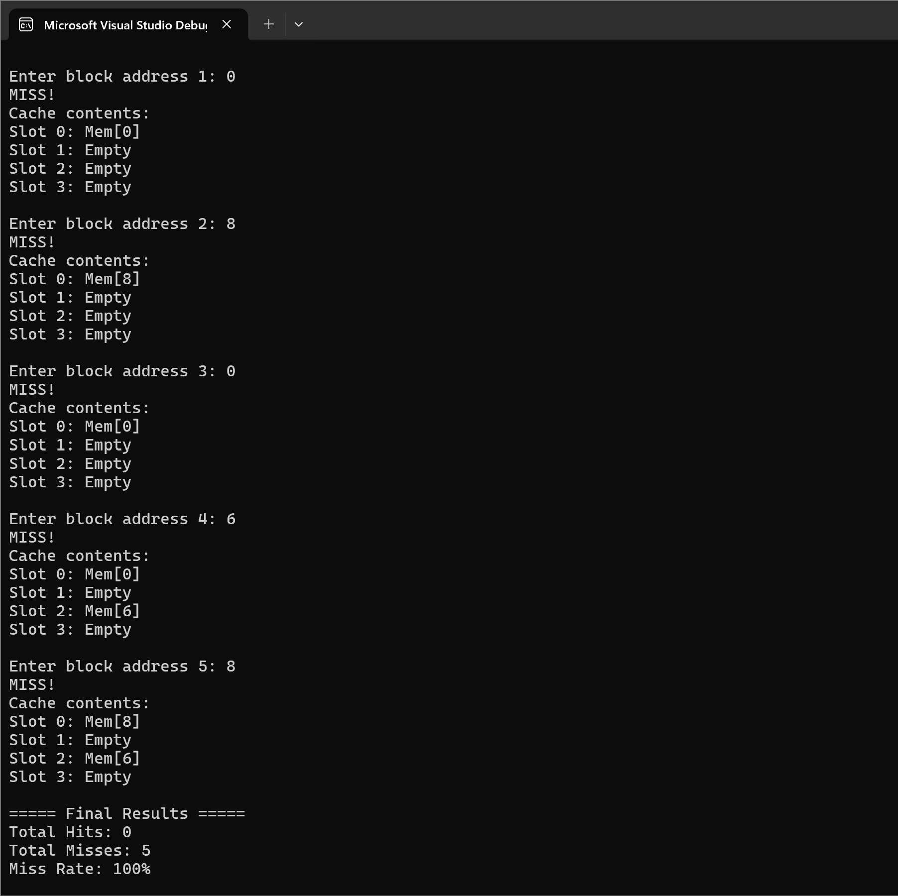
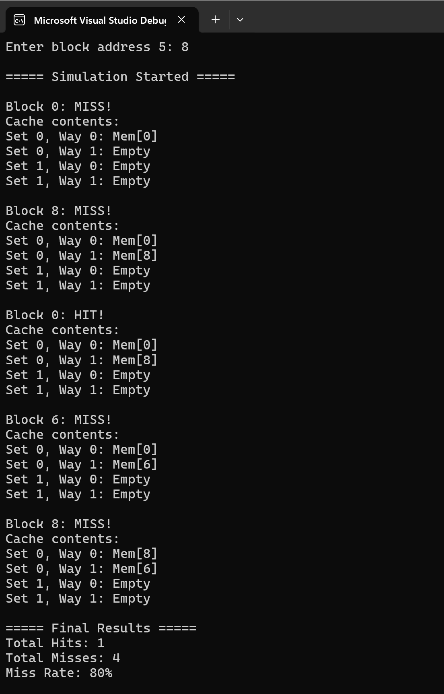
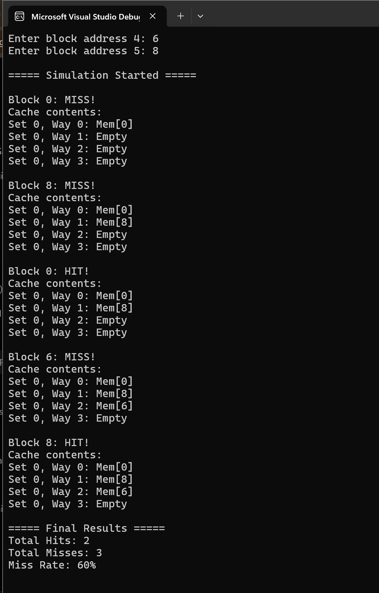
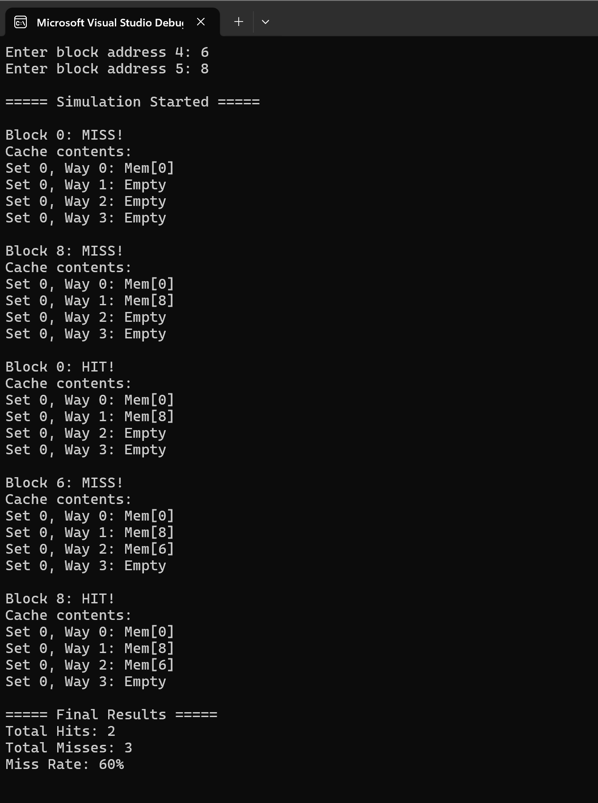

# C++ Cache Simulator

A console-based CPU cache simulator written in C++ for a Computer Architecture course project. It compares cache organizations by tracking memory block requests, cache hits and misses, and cache contents after every access.

## Features

- Four cache organizations: **direct-mapped**, **2-way set-associative**, **4-way set-associative**, and **fully associative**.
- **Least Recently Used (LRU)** replacement for associative caches when a set is full.
- Step-by-step display of cache contents after each memory reference.
- Summary of total hits, total misses, and miss rate.
- Input validation for cache size, organization, replacement choice, and memory addresses.

## Technologies and concepts

- **Language:** C++17
- **Development environment:** Visual Studio 2026 on Windows
- **Concepts:** CPU caches, direct mapping, set associativity, LRU replacement, `std::vector`, memory-access simulation

## Building and running

### Visual Studio

1. Create a C++ Console App project.
2. Add or replace its source file with `CacheSimulator.cpp`.
3. Build and run the project using **Ctrl + F5**.

### Command line with g++

```bash
g++ -std=c++17 CacheSimulator.cpp -o CacheSimulator
```

On Windows, run `CacheSimulator.exe`; on macOS/Linux, run `./CacheSimulator`.

## How to use

1. Enter a positive number of cache blocks.
2. Choose a cache organization (1–4).
3. If an associative organization is selected, choose LRU replacement (option 1).
4. Enter the number of memory references and each non-negative block address.
5. Read the per-access HIT/MISS results and final miss rate.

For 2-way or 4-way caches, the number of cache blocks must be divisible by the number of ways. The simulator treats input addresses as **memory block addresses** rather than byte addresses.

## Example results

With **4 cache blocks** and the reference sequence **0, 8, 0, 6, 8**, the program produces:

| Cache organization | Hits | Misses | Miss rate |
| --- | ---: | ---: | ---: |
| Direct-mapped | 0 | 5 | 100% |
| 2-way set-associative | 1 | 4 | 80% |
| 4-way set-associative | 2 | 3 | 60% |
| Fully associative | 2 | 3 | 60% |

In this particular input sequence, greater associativity reduces conflicting placements and results in fewer misses. Results depend on the access sequence and cache configuration.

## Screenshots

**Direct-mapped** (screenshot captured from an earlier version of the console output; the current source labels positions by set and way):



**2-way set-associative:**



**4-way set-associative:**



**Fully associative:**



## Project structure

```text
cache-simulator/
├── CacheSimulator.cpp
├── README.md
└── screenshots/
    ├── direct-mapped.png
    ├── two-way.png
    ├── four-way.png
    └── fully-associative.png
```

## Scope

This is an educational simulator of cache **block placement and replacement behavior**. It does not model actual CPU timing, byte offsets, write policies, multilevel caches, or cycle-accurate hardware behavior.
