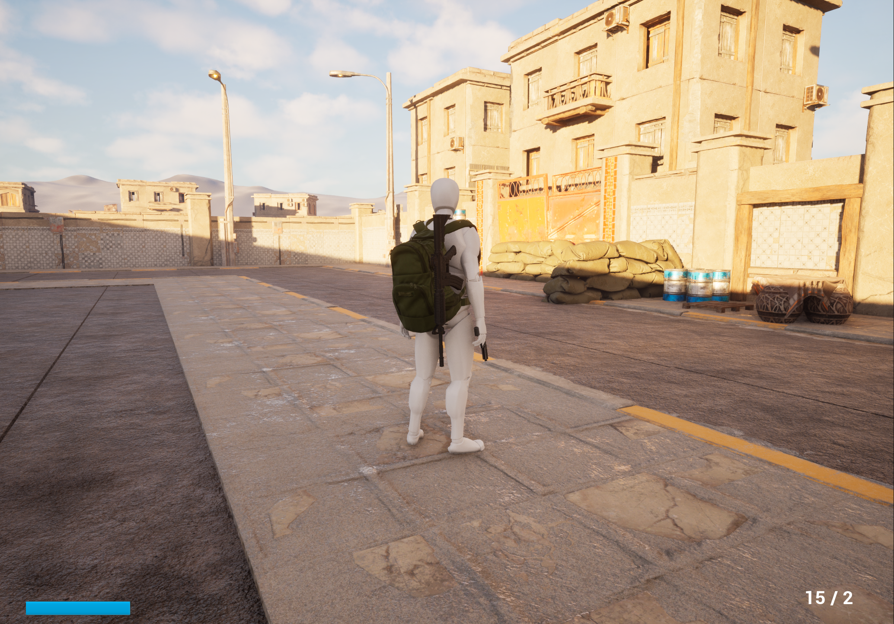

# Unreal Engine Combat Prototype

## Project Overview

This is an ongoing third-person combat project developed
using Unreal Engine 5 and C++.

The project focuses on gameplay programming, character
movement, weapon mechanics, animation systems, and
enemy artificial intelligence.

My goal is to develop reliable gameplay systems while
improving my understanding of C++, software architecture,
debugging, and Unreal Engine development.

## Technologies Used

- Unreal Engine 5
- C++
- Unreal Engine Blueprints
- Animation Blueprints and Montages
- Enhanced Input
- Visual Studio
- Git and GitHub

## Gameplay Features

### Player Movement

- Walking, running, and sprinting
- Jumping and crouching
- Directional movement and strafing
- Camera transitions when aiming
- Leaning while aiming

### Weapon System

- Pistol and rifle weapons
- Weapon pickup and equipment
- Weapon switching
- Ammunition and reloading
- Weapon holstering and unholstering
- Camera-based line tracing for shooting
- Muzzle flash and sound effects

### Enemy Artificial Intelligence

Enemy behaviors are implemented using C++.

Features include:

- Patrolling between assigned locations
- Field-of-view and line-of-sight detection
- Chasing and attacking the player
- Investigating the player's last known location
- Searching when the player is lost
- Taking cover and repositioning during combat
- Suppression behavior when receiving repeated hits
- Damage handling and headshot detection

### Animation Systems

The project uses Unreal Engine Animation Blueprints,
Blend Spaces, Montages, and Animation Notifies to
connect character animations with gameplay actions.

## Development Approach

The gameplay systems are primarily implemented in C++,
with Blueprints used for animation integration and
editor configuration.

I regularly test individual features, identify bugs,
and refine how different gameplay systems interact.

## Screenshot

## Project Status

This project is currently in development.

The complete Unreal Engine repository is private.
This public folder documents the project and
demonstrates its gameplay features.

Additional screenshots, demonstrations, and selected
source code may be added as development progresses.
